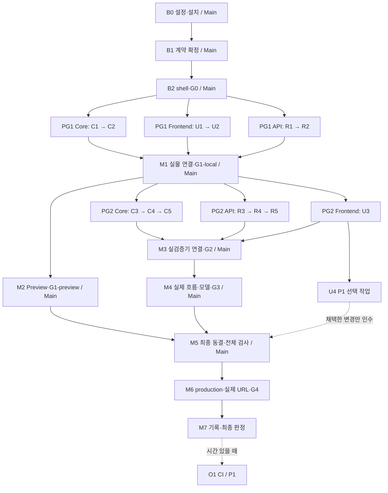

# Web MVP A–E 실행 계획 — Multi-Agent Edition

작성일: 2026-10-29. 목표는 같은 날 수업에서 시연할 수 있는 **합성 데이터 기반 Vercel Web MVP의 완성 및 실제 배포**다. 이 파일은 계획이며, 체크되지 않은 항목은 구현·검증 완료를 뜻하지 않는다. 계획 수립 후 구현을 시작했다. 체크 상태와 하단 Implementation log가 실제 진행 결과의 기준이며, 배포·실모델 검증 미완료 항목은 별도로 표시한다.

제품 요구사항의 기준은 [PRD.md](PRD.md), 개발·보안 기준은 [AGENTS.md](AGENTS.md)다. [README.md](README.md), [결정 기록](docs/decisions.md), [공통 코어 방향](docs/ccc-rag-architecture.md), [Skill 계획](docs/skills-plan.md)을 함께 검토했다. 충돌 처리 원칙은 마지막 절에 정리한다. 이번 개정은 기존 계획의 범위를 유지하면서 Main + 최대 3개 Subagent 실행으로 재배치한 것이다. 계획 확정 후 사용자 승인으로 구현을 시작했으며, 아래 체크리스트와 로그에 진행 상황을 반영한다. 이번 개정에는 의존성·파일 소유권·테스트 전략을 각각 담당한 3개 read-only subagent의 병렬 검토 결과를 반영했다.

## 1. Current State

### 현재 실행 결과

로컬 Core/API/UI 구현과 독립 리뷰를 마쳤다. 단위·통합168개, 검색 평가18개, 브라우저7개, lint/typecheck/build를 실제 실행해 통과했다. dev는 http://localhost:3000 에서 계속 실행 중이다. 전체 제품명과 manifest 기반 버전 표시도 추가했다. 현재 배포 버전은 v0.1.1이다. 루트 .env 로딩을 연결해 실제 무료 모델의 answered 응답과 원문 인용을 확인했다. 병행 세션의 첫 Production 배포 기록이 docs/deployment.md에 추가됐다. 이번 수정은 실제 URL의 버전과 AI answered 응답까지 확인했다. 전체 G4 브라우저 검증과 A–E 완료 판정은 아직 남아 있다.

### 착수 시점의 자산과 부족한 부분 (기준 기록)

| 영역 | 실제 상태 | 필요한 작업 |
| --- | --- | --- |
| 루트 `package.json` | private npm workspace 선언(`apps/*`, `packages/*`)만 존재 | 실제 workspace manifest, 의존성, lockfile, 실행 스크립트 |
| `apps/web/` | README만 존재 | Next.js App Router, TypeScript, Tailwind, UI, Route Handler |
| `packages/spec-core/` | README만 존재 | 타입·코퍼스·MiniSearch·근거 검증·단위 테스트 |
| `apps/mcp/` | 미래 기능 README만 존재 | 그대로 유지; 실행 패키지나 서버 추가 없음 |
| `data/demo/spec-v1.json`, `spec-v2.json` | 독립 창작 합성 요구사항 각 16개, 총 32개 | 스키마·고유 ID·참조 검증과 빌드 시 정적 연결 |
| `evals/questions.json` | Q1–Q10 및 기대 Requirement ID 준비 | 실제 검색 평가 러너와 실패·인용 검증 케이스 추가 |
| `.env.example` | 서버 전용 키 예시와 `openrouter/free` 기본값 준비 | 서버 설정 로딩·무료 모델 제한·Vercel 설정 |
| `.gitignore` | `.env*`, `.next`, `.vercel`, `/data/local/` 등 제외 | 추적 파일·번들·로그에 대한 실제 검사 |
| `.agents/skills/` | Navigator/Auditor 정의·README·실제 예시 기록 존재 | 유지; Web 런타임과 연결하지 않음 |
| 디자인 | `DESIGN.md`의 A안 Clear Desk·Pretendard 확정, `docs/design-previews/main-screen-layouts.html` 비교 시안 준비 | 실제 React UI로 구현; 메뉴 형태는 필요 시 별도 선택 |
| 테스트·배포 | 테스트 소스/러너/설정, CI, 앱 코드, 배포 URL 없음 | 테스트·lint·build 및 live 검증 |

정적 데이터 점검 결과: 실제 `documentId`는 두 버전 모두 `DKSI-SYNTHETIC`, `synthetic: true`다. 버전별 고유 Requirement ID는 16개이며 내부 references의 미해결 대상은 없었다. 같은 순번의 V1/V2 원문 16쌍 모두 다르다. 위임 공유(004), BLE 재시도(008), NFC 조건(010/011) 등 버전 차이와 조건·예외를 이미 포함한다. 평가 10개의 기대 ID는 모두 데이터에 존재한다. 이는 검색 품질이나 답변 정확성 검증 결과가 아니다.

현재 `dev`, `test`, `lint`, `build`는 설명을 출력하고 `exit 1` 하는 placeholder다. 실행 가능한 테스트는 없으며 이번 조사에서 이들을 통과했다고 주장하지 않는다. 로컬 환경에서 확인한 버전은 Node `v24.15.0`, npm `11.12.1`이다. 실제 채택 버전과 Vercel 지원 조합은 Phase 0에서 확인·고정한다.

Skill은 합성 V2에 대해 Navigator와 Auditor를 명시적으로 호출한 수동 예시가 각각 하나 기록되어 있다. 전체 활성화/비활성화·공격 입력 회귀 검증은 미완료다. 이 자산은 MiniSearch나 Web API가 구현되었다는 증거가 아니다.

## 2. Architecture & API Contracts

### 최소 데이터 흐름

```text
data/demo/*.json (빌드 시 정적 import, 원문 보존)
  -> SyntheticCorpusProvider -> MiniSearchRetriever
                                   ^
브라우저: 질문/버전/기본 topK=5       |
  -> POST /api/ask (Node.js, 입력 검증)
  -> 버전 필터 + 검색 -> Evidence[] (서버가 citationId/quote 생성)
     -> 근거 없음: insufficient_evidence, 모델 호출 없음
     -> 키 없음: search_only + sources
     -> OpenRouterProvider (서버에서 한 번, topK 이하 근거)
        -> 응답 스키마/인용/원문 검증
        -> answered 또는 llm_unavailable + sources + warnings
  -> UI: 상태/한국어 답변/근거 카드/전체 원문 확장
```

### 패키지 경계와 계약

- `apps/web` → `@dksi/spec-core` 단방향 의존. 공통 코어에 Next.js, React, OpenRouter SDK, 환경변수 접근, 브라우저 전역을 넣지 않는다.
- `packages/spec-core/src/types.ts`, `interfaces.ts`: Document/Requirement/Evidence와 최소 `CorpusProvider`, `Retriever`, `LLMProvider`, `EvidenceValidator` 인터페이스를 정의한다. ADR의 `listDocuments/getChunks/getSourceSpan`, `search`, `generateGroundedAnswer` 의도를 합성 요구사항 단위로 표현한다. PDF chunk 엔진·범용 플러그인 프레임워크는 만들지 않는다.
- `SyntheticCorpusProvider`는 정적 JSON을 주입받는다. `apps/web/src/server/corpus.ts`가 루트 `data/demo` 두 파일만 명시적으로 import하고 코어를 구성한다. 런타임 파일 읽기·쓰기나 `data/local` 탐색은 없다.
- `MiniSearchRetriever`는 heading/keywords/ID/section/text를 색인하고 `searchRequirements(query,{versions,topK})`, `getRequirement(citationId)`를 제공한다. 동점 정렬은 citationId로 고정한다. `getRelatedRequirements`는 필수가 아니며 참조 무결성 검사는 먼저 구현한다.
- 서버 모듈 singleton으로 읽기 전용 코퍼스/색인을 재사용하되, 질문·답변·사용자별 상태를 저장하지 않는다.
- `OpenRouterProvider` 구현은 `apps/web/src/server/llm/`에만 둔다. `LLMProvider` 타입은 코어에 두고 구현은 서버에서 주입한다. 응답 계약 타입은 UI에서 type-only import할 수 있게 분리한다.
- source ID는 `SRC:${documentId}:${version}:${requirementId}`. 예: `SRC:DKSI-SYNTHETIC:V2:DEMO-V2-REQ-010`. PRD 예시의 문서명·Section·ID를 실제 fixture 값으로 하드코딩하지 않는다.
- 초기 quote는 짧은 합성 Requirement의 **전체 text**를 사용해 조건 누락을 줄인다. fullText는 원문 그대로다. 검색 정규화는 별도 필드에만 적용하며 quote를 번역·정규화·재작성하지 않는다.

### API 동작 결정

입력은 PRD 계약 `{question, versions?, topK?}`를 유지한다. trim 이후 1–500자, `versions` 생략 시 전체, 제공 시 비어 있지 않은 V1/V2 배열, `topK` 생략 시 5 및 정수 1–8만 허용한다. 잘못된 타입·JSON·버전·범위는 HTTP 400, 과도한 본문은 413으로 처리하고 모델을 호출하지 않는다. API 오류의 JSON 형식은 앱 전용 계약으로 명시하고 정상 AskResponse와 구분한다.

정상 처리 응답은 PRD의 `{status,answer,sources,warnings}`를 유지한다. B1에서 다음 wire shape를 하나의 타입 정의로 고정한다.

```ts
type AskRequest = { question: string; versions?: ("V1" | "V2")[]; topK?: number };
type Evidence = {
  citationId: string; documentId: string; documentTitle: string;
  version: "V1" | "V2"; sectionId: string; requirementId: string;
  quote: string; fullText: string; score?: number;
};
type AskResponse = {
  status: "answered" | "insufficient_evidence" | "search_only" | "llm_unavailable";
  answer: string | null; sources: Evidence[]; warnings: string[];
};
type ApiError = { error: { code: "invalid_request" | "payload_too_large" | "internal_error"; message: string } };
```

문자 수는 trim 이후 Unicode code point 기준으로 계산하고 클라이언트 counter와 서버 검증을 맞춘다. valid request의 모델 실패는 HTTP 200 AskResponse로 반환하며, 잘못된 입력만 400/413 ApiError다. 복구 불가능한 앱 내부 오류는 500 ApiError로 처리해 유효 source가 있는 정상 fallback과 구분한다.

| 상황 | status / answer | 모델 호출 |
| --- | --- | --- |
| 검색 근거 없음 | `insufficient_evidence` / null, sources=[] | 0회 |
| 근거 있고 키 미설정 | `search_only` / null, sources 유지 | 0회 |
| 검증된 모델 답변 | `answered` / 한국어 문자열, sources 유지 | 최대 1회 |
| 429, 오류, timeout, 비정상 출력, 인용 검증 실패 | `llm_unavailable` / null, sources 유지 및 경고 | 최대 1회, 자동 재시도 없음 |

모델 출력은 내부 JSON 스키마(답변 문자열, 인용 ID 및 정확한 quote 목록)로 파싱한다. 반환 answer 안의 `[SRC:...]`도 모두 추출하여 목록과 대조한다. 알 수 없는 ID, 검색되지 않은 ID, 다른 버전, 빈/변조 quote, 인용 없는 실질 답변, 파싱 실패는 답변 전체를 보류한다. 확인된 sources는 버리지 않는다. 인용 검증은 출처 일치 검사이며 논리적 함의의 증명이 아니다. 조건·예외·불확실성은 프롬프트와 수동 평가에서 별도로 점검한다.

## 3. Implementation Phases / Task Breakdown

**실행 원칙:** Main 1명 + Subagent 최대 3명(Core / Frontend / API), 총 4개 실행 슬롯. Phase는 기능별 구분이며 시간상 전체를 직렬 실행하지 않는다. 모든 TODO에 ID·우선순위·담당·선행 조건을 붙인다. 아래 파일은 구현 예정 경로다. 준비 작업과 Gate는 Main이 순차 처리하고, 서로 다른 소유 파일의 구현만 병렬화한다.

**우선순위:** P0와 보안·출처 무결성·실제 배포 검증을 먼저 끝낸다. FR-14~17 및 추가 CI는 P1로서 시간이 부족하면 축소/보류하고 미충족 FR을 기록한다. 다만 P0 평가 질문에 필요한 최소 한영 처리, 안전한 렌더링, 기본 label/모바일 읽기, 최소 loading/중복 전송 방지는 정확성·안전의 기반이므로 유지한다. P1 전체 완료를 P0 배포의 선행조건으로 두지 않는다.

### Phase 0 — Main의 실행 기반·공통 계약 확정 (순차, P0)

- [x] **B0 · Main · 선행 없음:** README/PRD/AGENTS/DESIGN과 권한을 재확인하고 Node/npm·Next/React/TS/Tailwind/MiniSearch/Vitest의 호환 버전 및 Vercel 지원을 공식 문서로 확인한다. `package.json`, workspace manifests, lockfile, engines/버전 파일, tsconfig/ESLint/Vitest/Next/CSS 설정과 실제 dev/test/lint/build/eval 스크립트를 구성한다. 설치·의존성 변경은 Main만 수행한다.
- [x] **B1 · Main · B0 후:** `packages/spec-core/src/{types,interfaces,index}.ts`, `apps/web/src/contracts/ask.ts`에 Document/Requirement/Evidence, 네 provider 인터페이스, AskRequest/AskResponse/ApiError, 모델 내부 출력과 validator 반환 타입을 정의한다. §6의 계약 목록을 확정하고 각 agent에게 동일한 파일·export 목록을 전달한다. §2의 400/413·버전·topK·status 정책을 테스트 fixture로 고정한다.
- [x] **B2 · Main · B1 후:** 최소 Next shell과 실제 corpus import 스모크 테스트, 공유 응답 fixture를 추가한다. `src/server/ask-runtime.ts`에 B1의 `getAskService()` 타입·export 경계를 먼저 만든다. M1 전에는 미구성 오류를 명시적으로 발생시키며 가짜 성공/검색 결과를 반환하지 않는다. R2 테스트는 존재하는 이 모듈을 mock하고, M1에서 실제 조립으로 교체한 뒤 배포한다. `npm ci`, `npm run test`, `npm run lint`, `npm run build`로 G0를 검사한다. eval 스크립트는 실제 러너가 추가되기 전 사용 불가임을 표시하며 빈 성공으로 처리하지 않는다. Vercel 프로젝트/권한/Root Directory를 확인해 외부 계정 문제를 조기 발견한다. Pretendard 공식 WOFF2·라이선스 확보 방식도 이때 확정한다.

**G0 완료:** 설치·shell 빌드·실제 테스트가 동작하고, 계약/파일 소유권이 고정되어 PG1을 시작할 수 있다. 검색·AI 구현 완료를 뜻하지 않는다.

### Phase 1 — 검색 전용 Vertical Slice (PG1 병렬 → Main 통합, P0)

- [x] **C1 · Core · G0 후:** `src/corpus.ts`, `corpus.test.ts`에 JSON 주입형 SyntheticCorpusProvider를 구현한다. 기존 32개 원문의 필수 필드·synthetic·복합 ID·참조·버전을 검증한다. 원본 JSON은 수정하지 않는다.
- [x] **C2 · Core · C1 후:** `src/{retriever,evidence}.ts`와 테스트에 MiniSearch 색인·필드 boost·버전 선필터·기본 top5/상한8·복합 ID·원문 Evidence·getRequirement를 구현한다. 최소 알려진 질문과 Q8을 점검하고 Main에 함수 exports를 전달한다.
- [x] **U1 · Frontend · G0 후:** `src/app/{layout,page}.tsx`, `globals.css`, `src/components/{app-header,ask-panel,evidence-card}.tsx`를 A안·Pretendard로 구현한다. 질문/버전/합성 경고/원문 펼침/inert MCP를 만든다. 실제 메뉴 형태는 추가하지 않는다. Main 소유 fixture를 읽어 개발할 수 있으나 실제 실행 경로에 고정 결과를 남기지 않는다.
- [x] **U2 · Frontend · U1 후:** `src/client/ask-client.ts`, ask-panel을 실제 `/api/ask` 요청으로 연결하고 기본 오류/검색 전용/무근거 상태를 구현한다. 응답 타입은 Main 소유 계약을 type-only import한다. route 완성 전에는 로컬 테스트에서만 fetch fake를 주입한다.
- [x] **R1 · API · G0 후:** `src/server/{ask-service,request-validation}.ts`와 단위 테스트에 입력 검증·주입형 Retriever·무근거 무호출·검색 전용 응답을 구현한다. Core 구현 완료를 기다리지 않고 계약을 만족하는 fake retriever로 검사한다.
- [x] **R2 · API · R1 후:** `src/app/api/ask/route.ts`, `route.test.ts`에 Node runtime·본문 제한·400/413·no-store·서버 오류 비노출을 구현한다. Main의 `src/server/ask-runtime.ts` 조립 함수를 호출하도록 어댑터를 만든다. 이 조립 파일의 타입·export 경계는 B2에 존재하고 실물 조립은 Main이 M1에서 완성한다. 개별 검증은 주입형 service/route mock으로 하고 전체 빌드는 M1에서 수행한다.
- [x] **M1 · Main · C2+U2+R2 후:** 모든 writer를 잠시 멈추고 `spec-core/src/index.ts` exports, `web/src/server/corpus.ts`, `ask-runtime.ts`를 연결하고 `web/src/integration/**`에 실물 연결 테스트를 둔다. 정적 demo import → 실제 코어 → 실제 API → 실제 UI로 동작시키고 고정 응답·fake provider가 production 경로에 없는지 확인한다. 검색/버전/원문/API 통합 테스트·lint·build를 실행해 G1-local을 통과한다.
- [ ] **M2 · Main · M1 후:** 키 없는 Vercel Preview를 배포하고 실제 검색·버전·근거 카드·모바일 화면·정적 JSON 번들링을 확인한다(G1-preview). 이 작업 중 PG2는 G1-local 기준으로 시작할 수 있다. 배포 대상 커밋을 먼저 고정하고, 해당 커밋의 Git 연동 배포 또는 별도 임시 checkout에서 배포한다. PG2가 편집 중인 공유 worktree를 CLI로 직접 업로드하지 않는다.

**G1 완료:** 키 없이 브라우저 → 실제 API → 실제 검색 → 근거/원문이 동작한다. G1-preview까지 확인된 URL을 중간 배포 성과로 기록한다. AI 답변 없는 Vertical Slice를 최종 A–E 완료로 표시하지 않는다.

### Phase 2 — 검색 품질·근거 무결성 (PG2-Core, P0 중심)

- [x] **C3 · Core · G1-local 후:** `retriever.ts`, `synonyms.ts`와 테스트에서 한영 정규화·prefix·보수적 fuzzy·동점 정렬·음성 질문 판정을 개선한다. 모든 양성 Q1–Q7/Q9/Q10의 기대 ID가 top5에 들어가게 하고 Q8은 빈 근거로 유지한다. ID별 정답 하드코딩·원문 수정은 금지한다. **P1 FR-14:** 여유 시 최소 5쌍 이상 동의어를 확장 검증한다.
- [x] **C4 · Core · G1-local 후, C3와 같은 agent가 순차 수행:** `evidence-validator.ts`와 테스트에 source registry+retrieved allowlist, 문서/버전/ID·비어 있지 않은 정확 quote 검증을 구현한다. 위조·미검색·교차 버전·quote 변조를 거부한다. 단순 일치를 의미적 증명으로 표현하지 않는다. API agent는 확정 인터페이스의 fake validator로 먼저 작업한다.
- [x] **C5 · Core · C3+C4 후:** `evals/run.ts`, `evals/additional-cases.json`에 기존 10개 평가와 표현 변형·음성 케이스 러너를 추가한다. `evals/questions.json`의 원래 기대값은 유지한다. `npm run eval`의 실제 top5·기대 ID 포함·버전 누출·실패 exit code를 확인하고 결과를 Main에 전달한다.

**독립 완료 조건:** 코어 단위/평가 통과, 버전 누출 0, 원문·ID 일치. C3/C4는 API·UI의 작업 시작을 막지 않지만 검증기 실물 연결은 G2의 필수 조건이다.

### Phase 3 — AI 답변·실패 격리 (PG2-API, P0)

- [x] **R3 · API · G1-local 후:** `src/server/llm/{openrouter,prompt,response-schema}.ts`에 server-only LLMProvider를 구현한다. 무료 모델 allowlist와 기본 `openrouter/free`, 한국어 근거 프롬프트, topK 이하 context, 한 번 호출, 최대60초 timeout·Route90초 예산·2,400 총 생성 token 및 응답 크기 상한·자동 재시도 없음 정책을 적용한다. 실제 키 없이 fake fetch로 검증한다.
- [x] **R4 · API · R3 후:** `ask-service.ts`에 모델 JSON/answer 인용 대조와 EvidenceValidator 주입을 연결한다. 정상만 answered; 키 없음 search_only; 429/5xx/network/timeout/malformed/잘못된 인용은 answer=null의 llm_unavailable+동일 sources+warnings. C4가 끝나지 않았으면 명시적 fake로 검사하고 실물 연결 완료라고 하지 않는다.
- [x] **R5 · API · R4 후:** service/provider/route 테스트에서 성공·실패·무근거 무호출·요청 1회 상한·원문 전송 범위·키 비노출을 검사한다. 출처의 지시문을 실행하지 않는 프롬프트/안전한 응답 정책을 확인한다. 테스트는 네트워크와 실제 모델에 의존하지 않는다.
- [x] **M3 · Main · C5+R5+U3 후:** 세 writer를 멈추고 실제 Retriever+EvidenceValidator+OpenRouterProvider를 ask-runtime에 조립한다. exports·통합 fixture·상태 UI를 대조하고 test/eval/lint/build를 실행한다. core validator 거부를 service가 답변 보류로 처리하는 통합 검사를 포함한다(G2).

**G2 완료:** 실제 코어·검증기와 API가 결합되고 모든 실패에서도 검색 근거가 보존된다. 실제 무료 모델 성공은 G3에서 별도로 확인한다. provider 장애가 검색 배포를 막지 않게 한다.

### Phase 4 — A안 UI·상태·브라우저 검증 (PG2-Frontend + Main, P0/P1 분리)

- [x] **U3 · Frontend · G1-local 후:** `answer-panel.tsx`, 기존 UI/client 파일에서 네 정상 status와 입력/네트워크 오류·warnings·검증된 인용→근거 focus를 구현한다. pending·중복 submit 방지·오래된 응답 차단·안전한 text 렌더링을 적용한다. Main 소유 shared fixture로 API agent와 독립 검증한다. 375/390px·1280px에서 Pretendard/긴 ID/원문을 읽을 수 있어야 한다.
- [ ] **U4 · Frontend · U3 후, P1:** FR-15 예시 3개, FR-16 심화 keyboard/aria-live/대비·200% 확대·320px, FR-17 세분화된 loading/429 문구, 여유 시 시각 간격을 다듬는다. A안·Pretendard·기본 폼 label·비활성 MCP는 유지한다. G2는 U3만 기다리고 U4는 지연시키지 않는다.
- [x] **M4 · Main · G2 후:** Main 소유 `apps/web/e2e/ask.spec.ts`, Playwright 설정으로 실제 서버의 검색/버전/quote/확장/무근거/키 없음/비활성 MCP를 검증한다. 실제 AI는 별도 통제된 1회 확인과 조건·예외 수동 평가를 수행한다. 위임 권한·NFC 조건·시동 권한을 대조한다. 실제 성공 미확인은 FR-07 미확인으로 기록하고 전체 A–E 완료라 하지 않는다. U4는 해당 파일 소유권을 지키며 병행할 수 있으나 최종 브라우저 검사 전에 멈춘다.

**G3 완료:** 실제 사용자 흐름·안전·기본 모바일 화면이 동작하고 실제 모델 성공/미확인을 구분한 기록이 있다. P1 보류 항목을 표시한다.

### Phase 5 — 최종 배포·실측·인수인계 (Main 순차, P0)

- [ ] **M5 · Main · M2+M4 후:** 모든 writer를 멈추고 P1 반영 여부를 확정한다. 깨끗한 설치 기준 `npm ci`, `npm run test`, `npm run eval`, `npm run lint`, `npm run build`, `npm run test:e2e`를 실행하고 실패를 수정한다. 최종 검사 중에는 코드·lockfile·설정을 동시에 바꾸지 않는다.
- [ ] **M6 · Main · M5 후:** 최종 production 커밋/배포를 고정하고 Vercel 환경변수·Root Directory·정적 번들을 점검한다. §9의 배포 검증 체크리스트를 실제 URL에서 수행한다(G4). 실제 UI가 preview와 다른 커밋이면 최종 URL에서 다시 확인한다.
- [ ] **M7 · Main · M6 후:** README, workspace README, `docs/decisions.md`에 실제 설치/실행법·URL·커밋·결과·P1 보류·제공자 한계와 발표 순서를 기록한다. 전체 A–E 필수 수용 기준 충족 여부를 판정한다. 구현 단계마다 변경 파일/실행 명령과 결과/한계/다음 단계 보고를 남긴다.
- [ ] **O1 · Main · M7 후, P1:** 여유 시 `.github/workflows/ci.yml`에 비밀 없는 install/test/eval/lint/build를 추가한다. 배포를 기다리게 하지 않으며 추가 후 실제 workflow 결과는 별도 확인한다.

## 4. Dependency Graph



그림의 연속 ID 노드는 그 안의 TODO를 순차 수행한다는 뜻이다. **병렬 가능한 것은 형제 branch의 구현**이다. Core 실물 대기 없이 API는 fake Retriever/Validator, UI는 fixture로 진행하지만 G1/G2에서는 반드시 실물로 교체한다. C4 미완료 상태에서 AI 답변을 production에 활성화하지 않는다.

**병렬화 불가:** 설치/lockfile 갱신 → 공통 계약 확정, 실물 조립, 같은 파일의 수정, 최종 빌드·배포 대상 커밋 확정, 배포 후 해당 URL 검증. Vercel 업로드 완료를 기다리는 동안 독립된 PG2 구현은 가능하다.

## 5. Parallel Execution Groups / Integration Gates

| 그룹 | 진입 조건 | 병렬 작업 / Main 역할 | 통합 게이트·완료 조건 |
| --- | --- | --- | --- |
| 준비 | 없음 | Main B0→B1→B2; subagent 구현 금지 | **G0:** 계약/ownership 확정, 실제 smoke/test/lint/build 통과 |
| **PG1** | G0 | Core C1→C2 / Frontend U1→U2 / API R1→R2. Main은 계정·배포 설정 확인과 테스트 검토만 수행 | **G1-local(M1):** 실제 JSON/core/API/UI 연결, 키 없는 정상/무근거·버전 필터·원문 확인, test/lint/build |
| 조기 배포 | G1-local | Main M2. 3 subagent는 PG2 시작 가능; Main은 배포 커밋 고정·Git 연동/임시 checkout 배포 | **G1-preview:** 실제 Preview URL, monorepo/JSON 번들·검색 동작 확인 |
| **PG2** | G1-local | Core C3→C4→C5 / API R3→R4→R5 / Frontend U3(→U4 P1). Main은 exports·테스트 증거 검토, 중복 코드 수정 금지 | **G2(M3):** 실제 검증기 주입, 전체 test/eval/lint/build, UI status 일치·unsupported 답변 보류 |
| 회귀·보완 | G2 | Main M4; Frontend의 U4만 소유 파일에서 병행 가능. Core/API는 대기 또는 read-only 리뷰 | **G3:** 실제 브라우저/모바일/MCP/예외 의미 확인; 모델 실호출 결과는 별도 기록 |
| 최종 | G1-preview+G3 | Main M5→M6→M7, 필요 시 O1. writer 모두 종료·인수 | **G4:** 최종 전체 검사, production URL 수동 확인, 미충족 P1/외부 장애 공개 |

Gate 실패 시 해당 파일 owner에게 범위를 좁혀 재할당한다. UI 실패 때문에 Core를 재구현하거나, 단위 성공만으로 배포 검증을 생략하지 않는다. Main이 타 owner 파일을 수정해야 하면 먼저 writer를 멈추고 소유권을 회수한다.

## 6. Agent Assignment & File Ownership

아래 경로는 저장소 루트 기준이며, **하위 디렉터리 전체 소유보다 명시한 예외가 우선**한다. 소유권은 Gate 사이에 고정한다. 동일 파일에 writer가 두 명 생기지 않게 한다.

| 담당 | 수정 가능 파일/디렉터리 | 수정 불가·읽기 전용 | 선행 / 인수 조건 |
| --- | --- | --- | --- |
| **Main / Integrator** | 루트 package/lock/tsconfig/Vitest/Node 설정, 모든 workspace manifest·설정, `.env.example`, `.gitignore`, `spec-core/src/{types,interfaces,index}.ts`, `web/src/contracts/**`, `web/src/server/{corpus,ask-runtime}.ts`, `web/src/test-fixtures/**`, `web/src/integration/**`, `tests/smoke.test.ts`, `web/e2e/**`, Playwright 설정, 문서·CI·Vercel 설정 | 활성 agent 소유 소스는 동시 수정 금지 | B0–B2/계약 확정 후 위임; M1/M3/M5–M7 전체 통합·검증 책임 |
| **Core Agent** | `packages/spec-core/src/{corpus,retriever,evidence,synonyms,evidence-validator}.ts` 및 같은 이름 `.test.ts`, `evals/run.ts`, `evals/additional-cases.json` | 공통 types/interfaces/index, manifests/lockfile, 기존 `data/demo/**`, `evals/questions.json` | G0 후 C1/C2; G1-local 후 C3–C5. 단위·실제 eval 결과와 필요한 export 목록 제출; M3 전 eval은 구현 모듈을 직접 참조하여 새 public export를 기다리지 않음 |
| **Frontend Agent** | `apps/web/src/app/{layout,page}.tsx`, `globals.css`, `src/components/**`, `src/client/**`, 해당 영역 colocated 테스트·fixture, `src/assets/fonts/**` 및 폰트 license | API route, server/**, shared contracts/fixtures, manifests/lockfile, DESIGN/비교 HTML | G0 후 U1/U2; G1-local 후 U3/U4. A안/Pretendard·상태·원문·MCP 확인, production fake 없음 |
| **API Agent** | `apps/web/src/server/{ask-service,request-validation}.ts` 및 colocated 테스트, `src/server/llm/**`, `src/app/api/ask/{route.ts,route.test.ts}` | Main 소유 corpus/runtime/계약, UI/**, Core/**, manifests/lockfile | G0 후 R1/R2; G1-local 후 R3–R5. fake 의존성 단위 검사와 상류 실패·보안 결과 제출 |

B2까지 Main이 만든 `app/layout/page/globals.css`는 **G0에서 Frontend로 소유권 이전**한다. Gate 통합은 Main 소유 파일에 한정하며 기존 owner가 작업을 마치기 전 해당 경로를 건드리지 않는다. 신규 파일이 위 표에 없으면 먼저 Main에게 경로를 배정받는다. 하나의 `apps/web/**` blanket 소유권은 주지 않는다.

### 공통 계약 동결 항목 (B1 → G0)

- `Evidence`: citationId/documentId/documentTitle/version/sectionId/requirementId/quote/fullText/score? 필드 및 `SRC:DKSI-SYNTHETIC:Vx:...` 규칙.
- AskRequest/AskResponse 네 status, invalid input ApiError JSON, warnings를 표시하는 방법, versions 생략/빈 배열·topK·문자 수 기준. client가 server 모듈에서 타입을 import하지 않게 한다.
- Retriever 검색/조회 함수의 이름·sync/async·입출력·export, SyntheticCorpusProvider 생성자, Validator 입력(원본 registry+검색 evidence+candidate)/결과(유효 여부·경고), LLMProvider 입력·모델 출력 schema. provider 구현은 web에, 타입만 core에 둔다.
- `createAskService(dependencies)`와 Main의 `getAskService()` 조립점, route의 import 경로, production은 실제 의존성 사용·테스트만 fake 허용 규칙.
- Main 소유 shared fixture는 **원본 JSON에서 생성한 evidence**와 정상/무근거/fallback/모델 실패 후보다. 모든 agent는 읽기만 하며 독자적인 계약 복사본을 만들지 않는다. 악성·변조 fixture는 각자의 테스트 영역에 한정한다.

계약 변경이 필요하면 agent가 이유·영향 파일·관련 테스트를 Main에게 전달한다. Main이 영향받는 writer를 멈춘 뒤 공통 타입/fixture를 수정하고, 변경 내용을 동시 통보해 작업을 재개한다. 버전 체계나 별도 공유 패키지를 늘리기보다 작은 계약을 유지한다.

### 운영·인수 규칙

- Main이 각 agent에 **작업 ID, 허용 경로, 선행 Gate, 완료 조건, 읽을 계약/디자인, 금지 범위**를 담아 지시한다. 서브 에이전트의 재위임은 하지 않으며 최대 3개만 활성화한다.
- 같은 workspace를 공유하는 기본 실행에서는 변경이 즉시 보인다. Main만 install/commit/merge/push/배포하고, subagent는 파일 편집과 자기 영역 테스트만 한다. 다른 작업자의 변경을 지우는 reset/checkout/stash나 전체 format은 하지 않는다. 별도 worktree는 실제 충돌 위험이 생길 때만 Main이 만들고 통합 순서를 정한다.
- subagent는 완료 시 **변경 파일 / 실행 명령·실제 결과 / 미실행·한계 / Main 연결 필요 사항**을 보낸다. 파일을 만들었음과 실제 통합 통과를 구분한다.
- agent가 빨리 끝나면 read-only 교차 검토나 자기 소유 테스트를 수행한다. 다른 agent 소스를 임의 수정하지 않는다. 대기 시간이 구현 시간보다 길거나 작업이 매우 작으면 두 agent로 줄여 Main이 마무리한다.
- 각 Gate 전 writer 일시 정지 → 범위 이탈 diff 확인 → 실물 연결 → 테스트 → 결과 기록 → 다음 그룹 시작. `.next`/coverage 등 출력 디렉터리를 경쟁해서 쓰는 build/E2E는 Main만 실행한다.
- 독립 단위 테스트는 특정 파일로 제한하고 가능하면 coverage를 끈다. 공유 포트·dev server는 Main이 하나만 관리한다. agent별 `npm install`, 전체 build, 전체 snapshot 갱신은 금지한다.

### 예상 병목과 시간 제한 시 순서

전체 시간은 3분의 1로 줄어든다고 가정하지 않는다. 대략 `기반 + max(Core1, UI1, API1) + 통합1 + max(Core2, UI2, API2) + 통합2/회귀 + 최종 배포`이며 Preview 대기는 PG2와 겹칠 수 있다. 추정 분 단위 약속보다 Gate별 실제 시간을 보고 재배치한다.

1. B0/B1(도구·계약)과 M1/M3(실물 조립)은 공통 병목이다. Main은 디자인 재탐색 대신 이 경로를 먼저 푼다.
2. 한국어 검색 품질(C3)과 인용 보류 연결(C4/R4)은 검증 병목이다. API agent가 Core를 기다리지 않게 fake 계약을 쓰되 실제 통합 검증은 생략하지 않는다.
3. Vercel 권한·정적 JSON 번들·무료 모델 가용성은 외부 병목이다. G0에서 권한, M2에서 배포 경로를 조기 확인하고 provider가 불가해도 검색 Preview를 유지한다.
4. 남은 시간이 적으면 U4/O1/동의어 확장·미세한 시각 조정을 먼저 보류한다. P0에서 막히면 기능을 임의 삭제하지 말고 검색 전용 체크포인트와 미충족 FR-07/11 등을 명시한다.

## 7. Acceptance Criteria / PRD Traceability

Phase 번호는 기능별 매핑이며 병렬 시작 시점은 §5를 따른다. P0는 G4의 필수 기준이다. P1은 보류 가능하지만 미충족 목록을 남기며 전체 PRD 완료라고 표시하지 않는다. 테스트는 owner가 제출하고 최종 통과 판정은 Main이 내린다.

| 요구사항 | 작업 ID / Gate · 구현 Phase / 주요 파일 | 완료 증거 |
| --- | --- | --- |
| FR-01 | C1/C2 · G1 · 1 / corpus + 기존 JSON | 각 16개, synthetic, >=2 변화·조건/예외, 고유 ID·참조 검사 |
| FR-02 | B1/R1/U2 · G1/G2 · 1/3/4 / route, ask-panel | 한/영, blank·501자·잘못된 타입 거부; 500자 수용 |
| FR-03 | C2/C3/C5 · G2 · 1/2 / retriever, evals/run | 기본 5개, 모든 기대 ID top-5, 결정적 ID/정렬 |
| FR-04 | C2/C5/U3 · G2/G3 · 1/2/4 / retriever, UI | V1/V2/all; 검색·답변·원문에서 타 버전 누출 0 |
| FR-05 | C2/U1 · G1/G3 · 1/2 / evidence, evidence-card | 문서명·버전·Section·Requirement ID·정확 quote |
| FR-06 | U1/M4 · G3 · 1/4 / evidence-card | 전체 원문 펼침/접기 및 fixture와 일치 |
| FR-07 | R3/R4/M4 · G3/G4 · 3 / server/llm | server-only 무료 모델 한국어 답변 실제 확인 |
| FR-08 | C4/R4/M3 · G2 · 2/3/4 / validator, response parser | 위조/미검색/교차 버전 ID 및 quote 변조 거부, 의미 검증 한계 안내 |
| FR-09 | R1/C3/M3 · G2 · 1/2/3 / ask-service | Q8 및 추가 무관 질문: insufficient_evidence, answer=null, 호출 0 |
| FR-10 | R5/U3/M3 · G2 · 1/3/4 / provider, status UI | 키 없음/429/error/timeout/malformed에도 동일 sources 사용 |
| FR-11 | M2/M6 · G1-preview/G4 · 1 Preview, 5 최종 | 실제 Vercel URL과 수동 확인 기록 |
| FR-12 | U1/M4 · G3/G4 · 1/4 / page, e2e | dim + disabled + aria-disabled, href/라우트/탐색 없음 |
| FR-13 | U1/M6 · G1/G4 · 1/4/5 / layout/page | 지정 합성 경고 상시 노출, 내부 자료 요청 없음 |
| FR-14 (P1) | C3 · G2(선택) · 2 / synonyms | 한영 >=5쌍 및 표현 변형 검색 |
| FR-15 (P1) | U4 · G3(선택) · 4 / ask-panel | 질문 action 3개 동작 |
| FR-16 (P1) | U3/U4 · G3 · 4 / components, CSS | 375px/1280px 및 keyboard 수동 확인 |
| FR-17 (P1) | U3/U4/R5 · G2/G3 · 3/4 / service/UI | loading/429/fallback 구분, 중복 전송 방지 |

## 8. Testing & Integration Strategy

검사 순서와 담당: G0 Main 기반 검사 → PG1 각 agent 단위 → G1 Main 실물 통합 → PG2 각 agent 단위/평가 → G2 Main 실제 validator 포함 통합 → G3 Main 브라우저·의미 확인 → G4 Main 최종 배포. Mock 성공만으로 Gate를 넘지 않는다.

- **단위(Vitest)**: 코퍼스 구조·복합 ID·참조·원문 보존, query 정규화/동의어, 버전 제외, topK 경계 1/8과 잘못된 값, 안정적 순위, quote substring, 존재하지만 미검색인 ID와 위조 ID를 검사한다.
- **RAG 품질**: Q1–Q10의 원래 기대값을 유지한다. 양성 9개는 각 케이스의 모든 기대 ID가 top 5에 포함되어야 한다. 음성 Q8과 추가 무관 질문은 빈 근거여야 한다. 질문별 결과/실패 사유와 기대 ID 회수율을 출력한다. 이 작은 fixture 결과를 일반적인 검색 정확도로 홍보하지 않는다.
- **계약/통합(Vitest)**: Route Handler → 실제 코어 → fake LLM. 400/413, 응답 status, 무근거 무호출, 키 없음, 정상/429/5xx/timeout/네트워크/malformed/위조 인용, 호출 1회 상한, sources 보존을 검증한다.
- **브라우저(Playwright + 수동)**: 실제 API 검색 경로, 버전 변경, 원문 expansion, 오류 복구, 중복 전송 방지, inert MCP, 모바일 레이아웃을 확인한다. 실제 외부 모델은 자동 회귀의 필수 의존성에서 제외한다.
- **근거의 의미 수동 검토**: 위임 권한 subset/추가 위임 금지, NFC 권한 및 suspended 거부, entry-only와 시동 구분을 체크한다. 정확한 quote만 있는 오해의 소지가 있는 답변도 실패로 기록한다. 완전한 자동 entailment 판정은 목표가 아니다.
- **빌드/안전**: 루트 scripts가 실제 실패를 전달하는지 확인하고, Vercel에서 workspace·JSON 번들 포함과 Node runtime을 검사한다. tracked 파일과 Git 이력에 secret/private 파일 흔적이 있는지 값 비노출 방식으로 확인한다. 실자료 폴더를 열거나 원문을 수집하지 않는다.
- **Skill 별도 검증**: `.agents/skills/`는 수정·실행 의존성에 넣지 않는다. 전체 Skill activation/negative/adversarial 시험은 별도 수동 Codex 세션 기록으로만 인정하며 Web 테스트 통과로 대체하지 않는다. Web 배포의 선행조건으로 추가하지 않는다.

## 9. Vercel Deployment Plan

1. Phase 0에서 Next/Vercel/npm workspace 공식 문서로 지원 설정을 확인한다. 저장소를 Vercel 프로젝트에 연결하고 Framework=Next.js, Root Directory=`apps/web`으로 설정한다. 루트의 workspace/`data/demo` 파일을 빌드에 포함할 수 있는 상위 경로 접근 설정을 확인한다.
2. 루트 lockfile 기준 설치가 이루어지게 설정한다. 기본 auto-detection을 먼저 확인하고, 필요하면 저장소 루트에서 설치하도록 명시한다. Build는 web workspace를 대상으로 하며 core 빌드가 필요하면 선행한다. Output Directory는 Next.js 기본값을 사용한다.
3. M2 Preview는 키 없이 배포해 검색과 정적 데이터 번들링을 검증한다. `apps/mcp`, `.agents/skills`, 로컬 자료가 런타임 코드로 연결되지 않아야 한다.
4. Preview/Production의 서버 환경변수를 각각 설정한다. `OPENROUTER_API_KEY`는 선택적 secret, `OPENROUTER_MODEL=openrouter/free`가 기본이다. 키를 Git/클라이언트 props/응답/로그에 넣지 않는다. 설정 변경 후 재배포한다. 공개 `NEXT_PUBLIC_*` secret은 없다.
5. 기본 무료 라우터와 무료 모델 allowlist 외 유료 호출을 거부한다. 제공자 정책이나 privacy 옵션이 무료 라우팅과 충돌하면 실패를 fallback으로 처리한다. 실자료 전송 옵션·source/provider selector는 공개 MVP에 만들지 않는다.
6. **아래 checklist는 모두 M6 / Main / M5 완료 및 production 배포 후 수행**한다. production 배포 후 아래를 실제 URL에서 검사하고 URL·배포 시각·커밋·검사 결과를 README 또는 결정 기록에 남긴다.

- [ ] **D1 · M6 하위 검사 / Main / P0:** 합성 경고와 disabled MCP, 모바일/데스크톱 화면 확인.
- [ ] **D2 · M6 하위 검사 / Main / P0:** Q1(V1), Q3(V2), Q5(all)의 top-5와 원문 확장 확인.
- [ ] **D3 · M6 하위 검사 / Main / P0:** Q8 무근거와 invalid POST 검증; 모델 호출 없음 확인.
- [ ] **D4 · M6 하위 검사 / Main / P0:** 실제 AI 응답과 인용·조건을 수동 대조. 일시적 제공자 장애는 실제 발생 상태로 기록.
- [ ] **D5 · M6 하위 검사 / Main / P0:** 키 없는 Preview에서 검색 전용 확인; timeout/429는 자동 통합 테스트 또는 별도 통제된 환경에서 재현. 실제 장애가 없었다면 live 재현 완료라고 쓰지 않는다.
- [ ] **D6 · M6 하위 검사 / Main / P0:** 브라우저 네트워크/클라이언트 산출물에서 키·서버 설정 비노출, 콘솔 오류와 API 응답 확인.
- [ ] **D7 · M6 하위 검사 / Main / P0:** Vercel 배포 로그·함수에 루트 JSON 누락이나 런타임 쓰기 의존성이 없는지 확인.

Vercel 계정 접근/프로젝트 연결/secret 설정 권한이 없다면 필요한 외부 조치만 요청한다. 공개 MVP는 개인 비상업적 학술 시연용이며 회사 운영으로 전환하지 않는다.

## 10. Risks & Mitigations

| 위험 | 대응 및 검증 |
| --- | --- |
| 병렬 수정·공통 계약 변경 | Main 소유 exports/계약/lockfile, 경로별 writer 1명, Gate 중 정지 및 명시적 소유권 이전 |
| fake 성공·통합 지연 | 개발 중 fake 허용, G1/G2 실제 조립 강제, API·validator·UI를 함께 확인 |
| agent 슬롯·중복 도구 작업 | 최대 3 subagent, 재위임 없음, install/build/배포 Main 단독; 효과 낮으면 2개로 축소 |
| 무료 모델 가용성·쿼터·429 | 키 없는 검색을 먼저 배포; 1회/60초 상한, 출력 제한, 자동 재시도·유료 전환 없음; 성공 확인과 실패 검증을 구분 |
| 공개 endpoint의 반복 호출·비용/쿼터 소진 | 500자/본문/topK/출력 제한, UI 중복 방지, 배포 플랫폼에서 사용 가능한 요청 제한 확인; 저장소/DB 없이 적용. 인스턴스 메모리 제한만으로 전역 rate limit을 보장한다고 주장하지 않으며 필요 시 AI 키를 제거해 검색 전용 유지 |
| 한국어 lexical recall 부족 | >=5 동의어와 보수적 token/prefix/fuzzy, 기존 10개와 표현 변형 eval; embedding으로 오표기하지 않음 |
| 일반 용어 적중이 무관한 근거로 연결 | 음성 질문과 최소 적중 조건 점검; 애매하면 보류/한계 표시. 검색 점수를 의미적 확신으로 사용하지 않음 |
| 유효 인용을 단 오해·조건 누락 | 전체 Requirement quote, 조건·예외 보존 프롬프트, 위조 인용 보류, 수동 논리 검토; expert-reviewed 보장 금지 |
| prompt injection/XSS | 출처는 데이터로만 취급, tool 실행 없음, 모델/질문 raw HTML 렌더링 없음, 응답 스키마와 인용 allowlist |
| 비밀·실제 CCC 자료 유출 | 서버 전용 키, 합성 파일 명시적 import, `/data/local/` ignore, 로그 최소화, tracked 파일/이력/번들 검토 |
| 모노레포 root 밖 JSON 누락 | Phase 1 조기 Preview; 깨끗한 설치·build·실제 API로 번들 검증. 런타임 파일 복사로 우회하지 않음 |
| 시연 당일 범위 과잉 | 검색 전용 Vertical Slice 선행, AI 추가, UX 마무리 순서. MCP/PDF/DB/인증/복잡한 비교 엔진 제외; P0 누락을 완료로 숨기지 않음 |

## 11. Out of Scope / Future Work

키워드/AI 검색 전환은 사용자가 요청한 **첫 Vercel 배포·live 검증 이후의 후속 기능**으로 §13에 별도 계획한다. 현재 A–E 배포의 선행조건이 아니며 지금 구현하지 않는다.

이번 A–E에서는 다음을 구현하지 않는다.

- Local stdio MCP(F), 실제 MCP tool/server/endpoint/page 및 가짜 MCP 시연.
- 실제 CCC V3.1.4/V4.1.0 파일 확보·열람·파싱·색인, 사용자 업로드, `data/local` 처리, 로컬 Web 모드, Ollama·외부 실자료 전송 게이트.
- vector/embedding/hybrid retrieval, reranker, 전용 버전 diff/영향 분석 엔진, cross-spec 관계 그래프.
- 로그인·DB·사용자 질문/답변 영속화·회사 통합·ACL·공유 지식 저장소·분석 추적.
- Skill 파일을 웹앱이 실행하는 기능, 신규 Skill 확장, Skill을 RAG/MCP 구현으로 포장하는 동작. (Skill을 **소개만** 하는 정적 페이지는 §16 후속 기능으로 별도 계획한다.)

공유 네 가지 인터페이스와 무결한 원문·버전·인용 계약만 미래 확장 지점으로 남긴다. 후속 로컬 실증은 문서 이용 권한·조직 정책을 확인한 별도 계획으로 수행한다.

## 12. 문서 충돌·모호함 및 확인 사항

| 항목 | 이번 계획의 처리 / 확인 시점 |
| --- | --- |
| PRD §3은 후속 Ollama 답변을 언급하지만 최신 AGENTS/decisions는 회사 승인 에이전트+MCP, Ollama 선택이라고 명시 | A–E에는 영향 없음. 후속 방향은 최신 결정 기록을 참고하되 PRD 문구 정합성은 차후 정리할 항목으로 남김. 이번에는 어느 것도 구현하지 않음 |
| ADR은 source/inference selector, PDF/외부 처리 옵션, privacy 설정을 상세히 설명 | 미래 설계로 해석. 공개 MVP는 synthetic+OpenRouter만 제공하고 selector/추가 provider UI를 만들지 않음. provider privacy 옵션은 구현 시 호환성 확인 |
| ADR의 MCP가 본문 핵심 경로인 동시에 말미 P2로 표현됨 | 후속 우선순위는 별도 확정; 이번 F 제외에는 모호함 없음 |
| PRD 예시 `DKSI-DEMO`와 fixture의 `DKSI-SYNTHETIC`이 다름 | 예시는 계약 설명으로 해석하고 데이터가 실제 ID의 기준. 기존 fixture/Skill 예시를 변경하지 않음 |
| PRD의 Top 5와 API의 topK 1–8 | UI 기본 5, API는 1–8 허용; top-5 평가는 기본 설정 기준 |
| eval에 citation rejection/model-unavailable 사례가 없음 | 기존 10개 유지, 별도 validator/API fixture로 추가. 기존 파일만으로 전체 DoD 충족이라고 하지 않음 |
| 빈 versions, 잘못된 JSON, 실패 status 구분, invalid 인용 처리 세부가 미정 | 본 계획의 400/413 및 보수적 답변 전체 보류 정책을 기본으로 구현하고 `docs/decisions.md`에 기록 |
| 경과된 Skill 문서의 미검증 표현과 최신 예시 기록 | 최신 기록은 명시적 수동 1회씩만 인정. 전체 회귀 검증 완료로 확대 해석하지 않음 |
| 기존 계획은 P1 전체 완료를 선행조건처럼 표현 | 이번 사용자 요청에 따라 P0 우선·P1 보류 가능으로 변경. 보안/원문/기본 사용성은 유지하고 보류 FR을 공개 |
| 디자인·폰트·메뉴 | A안 Clear Desk와 Pretendard 확정 반영. 메뉴 형태 재검토는 실제 항목이 필요할 때; 이번은 비활성 MCP 유지. §16 Agent Skills 페이지로 실제 항목이 생겨 상단형 3항목 메뉴로 결정(S0에서 DESIGN 갱신) |
| 배포 계정/프로젝트/도메인, Vercel Node 및 실제 무료 모델 지원 | Phase 0/1에 확인; 커스텀 도메인은 필수가 아니며 생성된 live URL로 충분 |

이 항목들은 계획 검토 결과이며 이번 작업에서 기존 요구사항 문서를 수정하지 않는다. 실제 구현 때 새로운 결정·범위 이탈은 `docs/decisions.md`에 기록한다. 설치 버전과 계정 설정 외에는 현 정보로 Phase 0을 시작할 수 있으며, AI 제공자 장애는 검색·근거 배포를 막지 않게 한다.

## Implementation log — 2026-10-29

- G0: manifests/lockfile/Node 24/config/contracts/shell/shared fixture added. `npm install` (0 vulnerabilities), `npm ci --ignore-scripts`, `npm run test` (1/1), `npm run lint`, `npm run build` passed. Next.js 16.4.3, Vitest 5.0.5, MiniSearch 7.2.0. No search/AI implementation claimed yet.
- External blocker: `vercel whoami` rejected existing token. User asked to choose login or manual handoff; work continues independently. OpenRouter key setup requested without exposing any key.

- G1-local: Core/API/Frontend three-agent implementations integrated using actual JSON and retriever. `npm run test` 57/57, lint/build passed; Playwright `npm run test:e2e` 5/5 (real API fields/version, UI search/expansion, unsupported query, 375/1280px no overflow). M2 Preview remains blocked by invalid Vercel authentication. Dev server running at http://localhost:3000 with `.next-dev` isolated from production `.next`.

- G2: actual SourceEvidenceValidator + OpenRouterProvider composed. `npm run test` 159/159, `npm run eval` 18/18 cases and 17/17 expected IDs@5 (0 version leaks), lint/build passed. Original eval/corpus unchanged. Model parser/provider error paths mocked, not actual OpenRouter success. Three independent read-only review agents assigned next.

- Final local regression: Origin normalization fixed and covered for localhost/public HTTPS/cross-origin cases. `npm run test` 163/163, `npm run lint`, `npm run typecheck`, `npm run build` passed; browser tests 7/7 include explicit mocked answered UI (escaped HTML, citation focus), duplicate submit prevention and real search fallback. Independent security/quality/test-gap reviewers completed; suggested P0 test gaps were added. Original demo data, eval labels and Skills remain unchanged.
- Clean-source snapshot `/private/tmp/dksi-release-dl3x5k79`: `npm ci` from lockfile, test 163/163, eval 18/18, lint/build passed independently of the live dev server. Production dependency audit: 0 known vulnerabilities. This is local reproducibility evidence, not Vercel deployment evidence.
- Partial remaining tasks: U4 has examples/basic responsive states implemented, but full assistive-tech/IME/320px/200% audit deferred. M4 browser portion passed; actual model check unavailable because no API key. M5 local clean checks passed, but its M2/M4 prerequisites are not fully satisfied. M6/D1–D7 require actual Vercel URL. M7 documentation/manual deployment guide prepared; final deployment/model outcome pending. O1 CI deferred.
- Authentication recheck: Vercel CLI reports logged out, no local `.env.local` or process OpenRouter key configured. User credential/authentication questions remain pending. Manual steps are in `docs/deployment.md`; A–E overall completion is not claimed.

- Follow-up user request implemented in two parallel agents: full name in header/browser title and semantic Web version policy/display. Main integrated AppRelease above the signature footer. Version uses apps/web/package.json, baseline0.1.0; document V1/V2 remains independent. See docs/versioning.md. Full name/version browser regression passed below.

- Follow-up verification: lint/build passed without application build warnings, Vitest 163/163 and Playwright7/7 passed after full-name/version integration. Browser assertions read the Web package version instead of duplicating a release string. Isolated `npm version patch --workspace @dksi/web --no-git-tag-version` advanced both Web manifest and lock workspace entry to0.1.1; the isolated files were restored and actual baseline remains0.1.0.

### Follow-up user tasks

- [x] **N1 / branding agent:** Full product name in header and browser title; targeted lint passed.
- [x] **V1 / version agent:** Web version policy and manifest-backed AppRelease component; targeted lint passed.
- [x] **I1 / Main / N1+V1:** Place version above signature footer, document policy, verify build/test/browser including mobile overflow.

- Implementation commits: f10d484 (workspace/contracts/core), db91949 (RAG API/fallback), ecd4a81 (A안 UI/browser regressions), 9e45c29 (full name), dae2a24 (Web version policy/display). Documentation/report commit follows. These commits partition the final integrated source by responsibility; the final integrated tree, not every intermediate commit, was tested. No remote push or deployment is claimed.

- User follow-up: removed visible `Web` prefix; release stays above signature footer as `v0.1.0`. Root `.env` is now an optional Next configuration-time fallback (Node24 loadEnvFile), preserving process/app variable precedence. Dummy precedence check passed. Real key remains ignored and never printed, committed or uploaded. `.vercelignore` also excludes `.next-dev` caches.
- Actual OpenRouter through local app/server API: three explicitly bounded manual trials (no automatic retries). Trial1 topK5: citation validation withheld the response, 5 search hits retained. Trial2 diagnostic: 10s timeout. Trial3 topK1: HTTP200 answered in2508ms, one original V2 REQ012 source. Korean answer correctly states entry-only does not imply vehicle-start permission; exact source and citation manually checked. This confirms one real case, not general model reliability; default topK5 free-router availability/format variability remains a known limitation.
- M4 actual model check completed; G3 complete for tested local flows. Vercel CLI remains logged out. M2/M5(deployment prerequisite)/M6/D1–D7 remain pending actual Vercel setup/URL. Latest implementation push will precede the user's first deployment.

- Post-root-env regression: `npm run test`163/163, lint/build, Playwright7/7 passed with the E2E process key explicitly blank (root .env did not override it). Actual key scan across45 production/dev client files found no key in bundles. `.env` is ignored and excluded from commit/deployment. Release display is now `v0.1.0` without the Web prefix.

## 13. Post-Deployment Follow-up — 키워드 / AI 검색 전환

**상태: v0.1.1 첫 배포 및 핵심 live 검증 후 구현 진행 중.** 사용자 후속 승인에 따라 키워드/AI 검색 전환을 구현한다. 기존 PRD의 A–E 필수 수용 기준을 대체하거나 이번 배포를 지연시키지 않는다. 구현 시 PRD/DESIGN/결정 기록에 후속 요구사항을 반영한다.

### 목적과 동작 제안

- 질문 폼에 `검색 방식`이라는 레이블의 **`키워드 검색 / AI 검색` 두 선택지**를 추가한다. 버전 선택과 일관된 segmented radio control을 우선 검토한다. 기본 UI 선택은 **키워드 검색**을 제안한다.
- 키워드 검색은 기존 MiniSearch·한영 용어 확장·문서 버전 필터·동일 topK로 원문 근거만 반환한다. **서버에서 모델 생성 경로를 건너뛰므로 키가 설정돼 있어도 OpenRouter 호출은 0회**여야 한다. 화면에서 답변만 숨기는 방식으로 구현하지 않는다.
- AI 검색은 동일한 검색 결과를 근거로 한국어 답변을 생성하는 기존 RAG 경로다. 작은 설명으로 “검색된 근거를 바탕으로 AI 답변을 생성합니다”를 제공해 별도의 벡터/의미 검색 엔진으로 오해하지 않게 한다.
- 모드 전환·질문 편집·문서 버전 변경만으로 API를 호출하지 않는다. 사용자가 `근거 찾기`를 제출할 때만 선택한 모드로 실행한다. 기존 중복 전송 방지·timeout·자동 재시도 없음 정책을 유지한다.
- 질문과 문서 버전을 보존해 두 방식을 비교한다. 같은 `question + versions + topK`에 대해 모드별 최신 결과 하나씩만 현재 화면의 React 메모리에 보관하는 방식을 사용한다. 이미 받은 결과로 전환할 때는 추가 호출 없이 `이전 실행 결과`임을 표시하고, 해당 모드 결과가 없으면 실행 전 상태를 표시한다. 질문/버전이 달라지면 기존 결과를 새 질문의 결과처럼 보여주지 않는다.
- 모드별 결과에 제출 당시 질문·버전·요청 모드를 표시한다. AI를 요청했지만 실패한 경우 `AI 검색 · 답변 생성 불가, 검색 근거 표시`로 구분하고, 의도적으로 고른 키워드 검색을 AI 장애처럼 표시하지 않는다. 비교 전용 페이지·자동 재질문·DB·영속 캐시·질문 이력은 추가하지 않는다.

### 후속 API 계약 — S0 확정

```ts
// S0 확정: 선택적 mode를 추가하며 생략은 기존 AI 동작을 보존한다.
type SearchMode = "keyword" | "ai";
type AskRequest = {
  question: string;
  versions?: ("V1" | "V2")[];
  topK?: number;
  mode?: SearchMode;
};
```

UI는 `mode`를 항상 명시한다. **API에서 mode를 생략한 기존 클라이언트는 현재와 동일한 AI 경로**를 유지해 호환성을 보존한다. 빈 값·알 수 없는 문자열·잘못된 타입은 400으로 거부한다. 새 UI의 기본값 keyword와 기존 API의 생략 기본값 ai는 목적이 다르며 테스트로 구분한다. 응답의 네 status와 Evidence 구조는 유지하고, 결과의 요청 모드는 클라이언트가 제출 시 snapshot으로 보관한다.

| 요청/상황 | 응답 | 모델 생성 호출 |
| --- | --- | --- |
| keyword + 근거 있음 | `search_only`, answer=null, sources 유지 | **0회**, 키/모델 설정과 무관 |
| keyword 또는 ai + 근거 없음 | `insufficient_evidence`, answer=null, sources=[] | 0회 |
| ai 또는 mode 생략 + 근거/키 있음 | 기존 검증 후 `answered` 또는 `llm_unavailable` | 최대 1회 |
| ai 또는 mode 생략 + 키 없음 | 기존 `search_only` + 근거·정직한 안내 | 0회 |

동일 입력의 sources/순위/버전/quote는 두 모드에서 같아야 한다. 모드는 **생성 여부만 제어**하며 검색 설정을 바꾸지 않는다. 전체 무료 호출 제한이나 동시 사용자 쿼터를 보장하는 기능은 아니지만, 사용자가 명시적으로 키워드 모드를 고른 요청의 AI 호출은 제거한다.

### 후속 작업·의존성·파일 소유권

기존 Core는 변경하지 않는 것을 기본으로 한다. **Main + API/UI Subagent 최대 2개**를 사용하고, 공통 계약 확정 → 두 구현 병렬 → Main 실물 통합 → 다음 릴리스 배포 순으로 진행한다.

| 담당 | 수정 가능 경로 | 의존성 / 완료 조건 |
| --- | --- | --- |
| Main | `apps/web/src/contracts/ask.ts`, shared fixture, `src/integration/**`, `e2e/**`, PRD/DESIGN/PLAN/결정·버전 문서, Web manifest/lockfile | S0 계약·기본값 확정, S3 실제 연결·검증, S4 릴리스 |
| API Agent | `src/server/{request-validation,ask-service}.ts`, 관련 테스트, 필요 시 `app/api/ask/route.test.ts` | S0 후; 키가 있는 keyword 요청에서도 provider spy 0회, 기존 ai/fallback 유지 |
| UI Agent | `src/components/{ask-panel,answer-panel}.tsx`, `src/client/**`, `src/app/globals.css`와 관련 테스트 | S0 후; 기본 keyword, 명시적 제출, 모드별 최신 결과 비교와 요청 snapshot |

경로는 `apps/web/` 기준이며 Main 계약/fixture/설정 파일은 Subagent가 수정하지 않는다. 공통 파일 변경은 기존 §6 절차를 따른다.

- [x] **S0 · Main · G4 및 M7 후 / 후속 P1:** 배포 기준 커밋·버전을 기록한 뒤 위 mode 계약·UI 기본 keyword/API 생략 ai·모드별 메모리 결과 범위를 확정하고 PRD/DESIGN/테스트 fixture를 갱신한다. 첫 배포가 미완료이면 시작하지 않는다.
- [x] **S1 · API Agent · S0 후 / S2와 병렬:** mode 검증과 서버 생성 분기를 구현한다. keyword는 항상 retriever까지만 실행하고 모델 호출을 건너뛴다. ai의 인용 검증·실패 fallback·1회 상한은 유지한다. 설정된 fake 키/금지 모델에서도 keyword 결과가 정상이고 provider가 호출되지 않는 targeted 테스트를 제출한다.
- [x] **S2 · UI Agent · S0 후 / S1과 병렬:** 검색 방식 선택, 요청 mode 전달, 제출 당시 모드 표기, 의도된 keyword와 AI fallback 안내 구분을 구현한다. 전환만으로 호출하지 않고 동일 입력의 모드별 최신 결과를 재사용해 비교한다. 입력 변경·pending·재제출·모바일·keyboard 상태를 검사한다.
- [x] **S3 · Main · S1+S2 후 / Integration Gate G5:** 실제 UI→API→코어를 통합하고 아래 수용 기준과 test/eval/lint/build·관련 E2E를 실행한다. 단순 화면 상태가 아니라 서버 provider 호출 횟수를 검사한다. 기존 무근거·버전 격리·인용 거부·AI 장애 회귀가 통과해야 한다.
- [ ] **S4 · Main · S3/G5 후 / 다음 릴리스:** 호환 기능 추가로 Minor를 증가시킨다. 첫 배포가0.1.0이면 다음 목표는0.2.0이며, 실제 배포 기준이 다르면 그 버전에서 계산한다. 지금 버전을 올리거나 태그를 만들지 않는다. Preview→Production 배포 후 실제 URL에서 두 모드·표시 버전·키워드 무호출을 확인하고 결과를 기록한다.

### 수용 기준과 검증

- 기본 선택은 키워드이며 최초 방문·모드 전환·예시 질문 채우기로 API/AI 호출이 발생하지 않는다. 제출당 요청은 하나다.
- 서버 단위/통합에서 **키가 설정된 keyword 요청의 `generateGroundedAnswer` 호출 횟수 0**을 검증한다. ai는 근거·설정이 있을 때 최대1회, 무근거는0회다. 잘못된 mode는 검색/모델 실행 전에400이다.
- 같은 질문·versions·topK의 두 모드가 동일 source IDs/순위/quote를 반환한다. 키워드 모드가 버전 필터를 우회하거나 기존 검색 품질을 바꾸지 않는다.
- ai 정상 답변·키 없음·429·timeout·위조 인용 보류를 기존 정책대로 유지한다. UI에는 의도한 keyword 결과와 ai 실패를 구분해 표시한다.
- 브라우저에서는 기본 keyword 제출 payload, ai 선택 제출 payload, 전환만으로 추가 요청 없음, 기존 결과로 돌아가 비교 시 추가 호출 없음, 입력 변경 시 이전 결과 혼동 없음·중복 제출 방지를 검증한다. 모델 UI는 stub으로 검사하고 실제 모델 확인과 구분한다.
- 배포 후 실제 화면에서도 두 모드와 앱 버전을 확인한다. 요청 수 감소율을 실측하지 않고 수치로 주장하지 않는다. 이번 문서 수정만으로 구현·테스트·릴리스 완료로 표시하지 않는다.


## AI timeout investigation — 2026-10-29

이번 수정은 AI 실패 원인 수정이며, §13의 검색 방식 전환은 여전히 배포 후 미구현이다. 수정 소유권은 Main에 두고 provider/test/route/Web README/이 계획 파일로 제한한다.

- [x] **T0 / Main + read-only reviewers:** User-reported UI timeout matched server records at exactly10.0s. Provider default AND clamp were10,000ms; nonstream JSON required the complete body by that point; route budget was15s. Metadata-only instrumentation confirmed the configured free Nemotron model and was removed before completion. No key or source prompts were logged.
- [x] **T1 / Main / T0:** Wrote a fake-clock regression where a valid response arrives at12s. It failed with the original timeout, proving premature cancellation. Changed provider deadline/default clamp to60,000ms per user request and route maxDuration to90s (Fluid Compute budget), retaining abort/body cancellation,64KiB cap, one call and no retry.
- [x] **T2 / Main / T0:** Live NFC metadata separately showed finish_reason=length, all1,200 output tokens consumed,1,055 reasoning tokens, incomplete JSON. Increased the shared reasoning+visible-output budget to2,400. Kept strict JSON/citation validation and free-model allowlist; never display truncated responses. No model switch or paid fallback.
- [x] **T3 / Main / T1+T2:** Provider/service/route/schema targeted tests68/68 passed. Full unit/integration168/168, lint/build passed. Added late-header12s and late-body20s success, capped deadline abort, stalled-body cancellation and model budget < route budget checks.
- [x] **T4 / Main / T3:** Verify all three UI examples with actual configured free model, original topK5 and version scopes; manually compare successful answers to evidence; record format failures separately from timeouts. Rerun browser regression after final build, then commit/push.

Evidence before the final60s/2,400-token combination: live app sharing answered at11,253ms and start permission answered at13,544ms, both beyond the old10s cutoff; NFC at11,900ms fell back for format/provider failure. A separate same-query diagnostic confirmed token exhaustion rather than timeout. These measurements describe specific trials, not a latency guarantee. Vercel's90s budget requires deployment of the new route and verification against actual project settings/live URL.

- Final actual-app trials at60s/2,400-token budget, original UI questions/scopes/topK5: sharing answered7,416ms, NFC answered9,556ms, start permission answered3,545ms; no retries, all exact citations validated. Manually checked V1 prohibition vs V2 conditional single delegation, NFC permission/tap/suspension conditions and entry-only/start distinction. NFC answer translated passive entry as 수동 진입; attribution/condition checks pass but that domain translation is a remaining interpretation-quality issue, not a semantic guarantee. Future glossary refinement may preserve the English term.
- Final verification:168/168 unit/integration tests,7/7 browser tests, lint/build passed; independent read-only patch reviewer found no material timeout/resource/free-model-policy defect. Dev remains at localhost:3000. Vercel code now exports90s and must be redeployed/checked on the actual project; no live deployment claim. No keyword/AI mode toggle was implemented.

- Concurrent deployment handoff discovered before release: commits caa4535/67b5276 recorded first Production and Claude entry points. These changes were preserved. Released timeout fix as0.1.1 in commits617fc2e/0eb5af2 and pushed main. Production deployment dpl_Dap8KZSSqmKSMT1HcDQX2VS1M48H is Ready at https://digital-key-spec-intelligence.vercel.app; public HTML shows v0.1.1. An actual Production POST for V2 entry-only/start returned HTTP200, answered with no warnings, V2-only evidence, and the correct exact source citation DEMO-V2-REQ-012. This verifies the new release and one live answer; remaining full G4 browser/mobile checks are not implied complete.


## Search modes implementation log — 2026-10-29

- S0: baseline first Production v0.1.1, latest shared revision fb83427 (other session copy edits preserved). Main added SearchMode and optional AskRequest.mode, PRD FR-18/19 and DESIGN interaction rules. UI default keyword, omitted API mode ai, response unchanged; no Core changes. API/UI exclusive owners follow §13; Main owns contracts/integration/E2E/docs/release. Baseline npm run test168/168 passed.
- Read-only live reviewer: v0.1.1 desktop1280/mobile375 no overflow, inert MCP, actual Q5 answered with V1/V2 REQ008 ranks1/2, correct once vs two retries/backoff, citation focus and full-text expansion verified. Recent Vercel error-level function logs empty. Remaining cosmetic favicon404 will be fixed in follow-up. These are actual live checks, separate from stubbed E2E.

- S1 complete: API Agent changed request-validation/ask-service and tests plus route tests. Targeted73/73 passed; keyword with configured fake key and free/forbidden model skips generation/validator/network. Invalid mode rejected before runtime; omitted ai compatible.
- S2 complete: UI Agent changed ask-panel/answer-panel/globals.css/client tests. Default keyword, explicit mode, same-input two-slot memory, reused labels and snapshot context, pending controls and current-input invalidation implemented; 9 examples/user wording/footer preserved.
- S3/G5: Main added actual runtime/real retriever-provider-validator mode integration and browser regressions. Full npm run test198/198, eval18/18 (17/17 expectedIDs@5), lint/build and E2E9/9 passed. Fixed repeated-Response test fixture consumption (new Response per fake fetch), not runtime behavior. Keyword/ai source equality and zero keyword calls proven; E2E AI states explicitly stubbed, live-model proof recorded separately. Cross-review by API/UI agents found no material defect. Added icon.svg for live favicon404. S4 release/live checks next.


## 14. Follow-up — 카드별 일치 검색어 표시와 하이라이트 (PRD FR-20)

**상태: H0–H4 구현·로컬 검증 완료 (2026-10-29), 미배포.** 키워드 검색 결과만 보면 각 카드가 왜 나왔는지 알기 어렵다. 카드마다 실제로 일치한 검색어를 칩으로 보여주고 원문에서 해당 단어를 강조한다. 전체 확장 검색어 목록은 보여주지 않는다(decisions 2026-10-29). 검색 순위·버전 필터·quote 원문은 바꾸지 않는다.

### 계약 (호환 추가)

```ts
// packages/spec-core/src/types.ts — Evidence의 선택 필드
interface MatchedTerm {
  term: string;                 // 색인된 원문 용어(정규화된 소문자)
  fields: string[];             // requirementId | sectionId | heading | keywords | text
  viaSynonym: boolean;          // 원래 질문만으로는 일치하지 않고 동의어 확장으로만 일치
  ranges: [number, number][];   // fullText 안의 [start, end) 위치, text에서 일치하지 않으면 []
}
interface Evidence { /* 기존 필드 */ matches?: MatchedTerm[] }
```

- Core가 MiniSearch 결과의 `match`(현재 버림)로 채운다. `viaSynonym`은 동의어 확장 없이 원래 질문으로 한 번 더 검색해, 그 결과에 없는 용어로 판정한다. 순위는 기존 확장 검색 결과를 그대로 쓴다.
- ranges는 Core가 같은 tokenizer/정규화로 fullText에서 계산한다. UI는 위치만 잘라 `<mark>`로 감싸고 문자열을 재구성하지 않는다. `dangerouslySetInnerHTML` 금지. 잘못된 범위는 무시한다.
- ID 직접 조회와 `getRequirement`는 matches를 넣지 않는다. LLM 프롬프트는 기존처럼 필요한 필드만 전달해 matches가 모델로 가지 않는다. 인용 검증은 변경 없음.

### 작업

| ID | 담당 파일 | 내용 / 완료 조건 |
| --- | --- | --- |
| H0 | PLAN/PRD/DESIGN | 계약·표시 규칙 확정. DESIGN의 “확인되지 않은 하이라이트 금지”를 “서버가 일치를 확인한 단어만 강조”로 구체화 |
| H1 | `packages/spec-core/src/{types,retriever}.ts` + test | matches 생성. 알려진 질문의 칩 용어·동의어 표시·ranges가 원문과 일치, V1 전용 검색에 V2 없음, quote/fullText 불변 |
| H2 | `apps/web/src/client/highlight.ts` + test | ranges로 텍스트 분할. 겹침 병합·범위 밖 무시·quote 오프셋 처리 |
| H3 | `apps/web/src/components/evidence-card.tsx`, `globals.css`, `content/ui-text.json` | 카드에 일치 검색어 칩(동의어 표시 포함)과 quote·전체 원문 하이라이트. 키워드/AI 두 모드 공통 |
| H4 | `e2e/**`, `docs/decisions.md` | 브라우저에서 칩·`<mark>` 표시와 기존 E2E 회귀 확인. test/lint/build/eval 실행 후 결과 기록. 배포는 별도 승인 |

### 진행 기록

- [x] H0–H3 구현. 탐침 중 지난 커밋의 개요 키워드 `디지털 키`·`digital key`가 `키`/`key`로 쪼개져 무관한 질문(키 폐기·revoked key)에 개요 카드를 올리는 문제를 발견해 `digital`로 정리했다. “디지털 키가 뭐야?”는 `디지털` 동의어와 `디지털키` 앞부분 일치로 계속 찾는다.
- [x] H4 로컬 검증: `npm run test` 210/210, `npm run eval` 21/21, lint·typecheck·build 통과, E2E 10/10(칩·`<mark>`·quote 원문 동일 확인 추가). 1280/375px 카드 스크린샷 확인. 배포·live 확인은 아직 하지 않았다.

### 수용 기준

- “디지털키가 뭐야?” → `OVR-001` 카드에 `디지털키` 칩과 동의어로 표시된 `digital` 칩, 원문의 “digital”만 강조.
- “owner device 등록할 때…”(V1) → `REQ-001` 카드에 `provisioning` 등 동의어 칩이 표시되고, 원문 강조 위치를 잘라낸 문자열이 칩 용어와 대소문자 무시 일치.
- 강조 전후 카드의 텍스트 내용(`textContent`)이 원문과 동일. V1 전용 결과에 V2 없음. 기존 test/E2E/eval 통과.

## 15. Follow-up — 브라우저 로컬 질문 이력 (PRD FR-21)

**상태: Q1–Q3 구현·로컬 검증 완료 (2026-10-29), 미배포. 우선순위 P1 (2026-10-29 P2에서 상향).** 사용자가 이전 질문과 결과를 다시 볼 수 있게 한다. 로그인이 없으므로 서버·DB에 저장하지 않고 브라우저 `localStorage`에만 둔다. 전체 사용자 질의 로그 수집(분석·eval 보강)은 서버 영속화와 사내 문구 유입 위험이 있어 이 범위에서 제외한다. UI는 DESIGN §6 “질문 이력” C안(입력창 아래, 기본 접힘, 최근 5건)을 따르고, B안(헤더 버튼 + 드로어)은 사용 후 전환할 대안으로 기록했다. 시안: `docs/design-previews/question-history.html`.

### 저장 형식 (클라이언트 전용)

```ts
// apps/web 클라이언트 전용. spec-core·API 계약은 바꾸지 않는다.
interface HistoryEntry {
  id: string;
  question: string;
  mode: "keyword" | "ai";
  versions: string[];
  topK: number;
  submittedAt: string;   // ISO
  appVersion: string;    // apps/web/package.json
  response: AskResponse; // status, answer, sources, warnings 그대로
}
// key 예: "dksi.history.v1", 최신순 최대 5건
```

- 같은 question(정규화)+mode+versions는 기존 항목을 지우고 맨 앞에 새로 넣는다. 6번째부터 가장 오래된 항목을 버린다.
- 읽을 때 기존 클라이언트 응답 guard로 검사하고 잘못된 항목은 버린다. 모든 접근은 try/catch, 저장 불가·용량 초과 시 이력 없이 정상 동작한다.
- 스냅샷을 열면 해당 모드의 FR-19 메모리 슬롯에 넣고 다른 모드 슬롯은 비운다. 네트워크 요청은 없다. `다시 실행`은 일반 제출과 같다.
- 이력은 서버·LLM·분석 도구로 보내지 않는다.

### 작업

| ID | 담당 파일 | 내용 / 완료 조건 |
| --- | --- | --- |
| Q0 | PRD/PLAN/DESIGN/AGENTS/decisions | 범위·저장 원칙·C안/B안 기록 (이번 세션 완료) |
| Q1 | `apps/web/src/client/history.ts` + test | 읽기·쓰기·중복 교체·5건 제한·삭제·전체 삭제, 손상 데이터·storage 예외 처리 |
| Q2 | `apps/web/src/components/` (이력 섹션), `ask-panel.tsx`, `globals.css`, `content/ui-text.json` | 접힘 목록, 행 메타, 스냅샷 복원 배너, `다시 실행`, 앱 버전 불일치 경고 |
| Q3 | `e2e/**`, `docs/decisions.md` | 새로고침 후 유지, 스냅샷 열 때 요청 0건, 삭제, 모바일 375px 확인. test/lint/build/eval 결과 기록. 배포는 별도 승인 |

사용자에게 보이는 기능 추가이므로 출시 시 Web 버전 Minor를 올린다(docs/versioning.md).

### 진행 기록

- [x] Q1 `client/history.ts`: 읽기·추가(같은 질문+모드+버전 교체)·5건 제한·삭제·전체 삭제. 기존 응답 guard `isAskResponse`를 export해 저장 항목을 검사하고, 손상·위조 항목은 버린다. storage 차단·용량 초과 시 메모리 목록만 유지. React에는 `useSyncExternalStore` 어댑터(`historyStore`)로 연결해 서버 렌더·hydration은 빈 목록을 쓴다.
- [x] Q2 `components/question-history.tsx` + `ask-panel.tsx`: 폼 아래 접힌 `최근 질문 N건`, 행(질문 한 줄·모드·버전·결과 요약·시각)·행별 삭제·전체 삭제. 행을 열면 폼 조건과 해당 모드 결과 슬롯을 복원하고 `저장된 결과` 배너·`다시 실행`(일반 제출과 동일)·앱 버전 불일치 경고를 표시한다. 요청 0건.
- [x] Q3 `e2e/history.spec.ts`(병행 FR-22 작업과 겹치지 않게 별도 파일): 6건 → 새로고침 후 5건·최신순·기본 접힘, 열기 요청 0건과 `다시 실행` 1건, 삭제·전체 삭제 유지, 손상 JSON·위조 항목 무시, 이전 버전 경고, 375px 가로 스크롤 없음. `npm run test` 215/215, E2E 16/16, lint·typecheck·build 통과. 1280/375px 스크린샷 확인. 배포·Minor 버전 올림은 아직 하지 않았다.

### 보류

- `더 보기`/5건 초과 보관: 사용해보고 결정. 필요하면 B안 전환과 함께 검토한다.
- 스냅샷에 FR-20 `matches` 포함 여부: 응답을 그대로 저장하므로 자동 포함된다. 별도 처리는 하지 않는다.

### 수용 기준

- 질문 6건 제출 후 새로고침 → 최근 5건만 최신순으로 보이고 기본은 접혀 있다.
- 이력 행을 열면 `/api/ask` 요청이 발생하지 않고, 폼과 결과가 저장 당시 조건·응답과 같다.
- 행 삭제·전체 삭제가 즉시 반영되고 새로고침 후에도 유지된다.
- `localStorage`에 잘못된 JSON을 넣거나 접근을 막아도 페이지와 검색이 정상 동작한다.
- 기존 test/E2E/eval 통과.

## 16. Follow-up — Agent Skills 소개 페이지 (PRD FR-22)

**상태: S0–S3 구현·로컬 검증 완료 (2026-10-29), 미배포. 우선순위 P1 (2026-10-29 P2에서 상향 — 당일 발표에서 보여줄 페이지).** 발표에서 이 프로젝트가 단순 RAG 챗봇이 아니라 **스펙 탐색·검증 절차를 표준화하는 프로젝트**임을 보여주기 위해, 웹앱에 `Agent Skills` 메뉴와 정적 소개 페이지를 추가한다. 웹앱은 서비스형 인터페이스, Agent Skills는 개발자 워크플로형 인터페이스이며 향후 Local MCP로 같은 검색 도구에 연결하는 방향이다. **현재 두 인터페이스는 서로 호출하지 않는다.** 페이지는 이 구분을 숨기지 않고 설명하는 것이 목적이다.

### 우선순위

- 오늘(10/29) 발표에서 이 페이지를 직접 보여준다. 발표의 중심은 여전히 업무 적용 사례와 Web RAG의 검색·근거 시연이며, 이 페이지는 프로젝트 전체 그림과 확장 방향을 30~60초에 설명하는 용도다.
- P1이지만 핵심 RAG 경로(`/api/ask`, spec-core, 검색 화면 동작)는 수정하지 않는다. §15 FR-21과 파일이 겹치지 않게 헤더·새 라우트·CSS 끝부분만 건드린다.

### 페이지 성격 — 프로젝트 랜딩 페이지

Skill 목록 페이지가 아니라 **프로젝트와 Skill을 소개하는 랜딩 페이지**다. 첫 화면에 아래 핵심 메시지를 그대로 노출한다.

> Digital Key Spec Intelligence는 단순한 RAG 챗봇이 아니라, 스펙 탐색과 검증을 표준화하는 프로젝트다. 웹앱은 서비스형 인터페이스이고, Agent Skills는 개발자 워크플로형 인터페이스다.

흐름: Hero(핵심 메시지 + `Spec Explorer 열기`·GitHub CTA) → 문제(개발자마다 각자 AI에 스펙을 넣어 질문 → 중복 검색·버전 혼동·근거 검증 어려움) → 두 인터페이스 비교(Web RAG / Agent Skills, “서로 호출하지 않음” 명시) → Skill 카드 2개 → Roadmap. 디자인은 기존 A안 토큰·Pretendard를 유지하되 검색 화면보다 큰 hero 타이포와 넉넉한 섹션 간격을 허용한다(DESIGN §6에 기록).

### 화면 구성

```text
헤더:  [Spec Explorer]  [Agent Skills]  [Local MCP · Coming soon (disabled)]
        /  현재 검색 화면   /skills 랜딩    기존 FR-12 그대로

/skills
  Hero: 핵심 메시지 · [Spec Explorer 열기] [GitHub]
  Problem: 각자 AI에 스펙 → 중복 검색 · 버전 혼동 · 근거 검증 어려움
  Two interfaces: Web RAG(서비스형, Live) | Agent Skills(개발자 워크플로형, 2 Skills)
  ⚠ Skills are not executed by this web application.
     Codex 등 호환 에이전트 클라이언트에서 저장소를 열고 사용합니다. (현재 실행 기록: Codex)

  [Spec Requirement Navigator]           [Spec Answer Auditor]
   목적 / 사용 시나리오                     목적 / 사용 시나리오
   $spec-requirement-navigator             $spec-answer-auditor
   예시 프롬프트 (복사 가능한 텍스트)          예시 프롬프트
   상태: SKILL.md 작성 · Codex 수동 실행 1회   상태: 동일
   README · SKILL.md (GitHub)              README · SKILL.md (GitHub)

  Roadmap
   1. Web RAG — 합성 데이터 웹서비스            Live
   2. Agent Skills — Navigator / Auditor      정의 · 수동 검증
   3. Local MCP — 실제 CCC 자료 + 사내 승인 AI   Planned
```

### 콘텐츠 원칙

- 출처는 각 Skill의 `README.md`·`example.md`. 예시 프롬프트는 합성 코퍼스로 실제 답할 수 있는 것만 쓴다(Navigator: “가상 V2 스펙에서 UWB ranging 실패 시 NFC fallback이 가능한 조건…”, Auditor: “방금 spec-requirement-navigator가 작성한 답변을 검증해줘.”).
- 링크는 `https://github.com/yenarue/digital-key-spec-intelligence/blob/main/.agents/skills/<name>/{README,SKILL}.md`. 추적 파라미터(`utm_*`)는 붙이지 않는다.
- 상태 문구는 기록된 검증만 쓴다: 각 Skill 명시적 Codex 수동 실행 1회. 전체 activation/negative/adversarial 회귀는 미완료로 표시하거나 언급하지 않는다. “Tested”, “Integrated” 같은 표현 금지.
- 실행 클라이언트는 “Codex CLI” 하나로 한정하지 않는다. `.claude/skills` symlink로 Claude Code도 발견할 수 있으나, 실행 기록이 생기기 전에는 검증된 클라이언트로 표시하지 않는다.
- 합성 데이터 경고(헤더 demo tag)는 이 페이지에서도 보인다. 실제 CCC 내용이나 사내 정보를 넣지 않는다.
- 실행·체험 버튼, Skill 호출, `/api/*` 호출, LLM 호출, MCP 페이지·endpoint를 만들지 않는다. 새 의존성 없이 정적 콘텐츠로 구현한다.

### 작업

| ID | 담당 | 파일 | 내용 / 완료 조건 |
| --- | --- | --- | --- |
| S0 | Main | PRD/PLAN, `DESIGN.md`, `docs/decisions.md` | 범위·문구 원칙 확정. DESIGN “메뉴 확장 원칙”을 상단형 3항목 메뉴(현재 위치 `aria-current`, 좁은 화면 줄바꿈, MCP disabled 유지)로 갱신하고 결정 기록 |
| S1 | Frontend Agent | `apps/web/src/components/app-header.tsx`, `globals.css`, `content/ui-text.json` | `Spec Explorer`/`Agent Skills` 링크 추가, 현재 위치 표시, `Local MCP` 버튼은 그대로. 375px에서 가로 스크롤 없음 |
| S2 | Frontend Agent | `apps/web/src/app/skills/page.tsx`, `content/agent-skills.json`(또는 ui-text 하위), `globals.css` | 위 화면 구성의 정적 페이지. 기존 A안 토큰·카드 스타일 재사용, 새 디자인 시스템 만들지 않음. 서버/클라이언트 데이터 요청 없음 |
| S3 | Main | `apps/web/e2e/**`, `docs/decisions.md` | 헤더 이동·`aria-current`·키보드, `/skills`에서 `/api/ask` 요청 0건, MCP 비활성 유지, 링크 URL 형식, 1280/375px 확인. test/lint/typecheck/build/eval/E2E 실행 결과 기록. 배포는 별도 승인 |

- 발표 당일 일정상 S1–S2도 Main이 직접 구현한다(위임 비용 대비 작업이 작음). 병행 세션의 FR-21 작업과 겹치지 않도록 `ask-panel.tsx`는 건드리지 않는다.
- 발표 대본은 저장소 밖(사용자 Google Drive 과제 폴더)에 둔다.
- 사용자에게 보이는 기능 추가이므로 출시 시 Web 버전 Minor를 올린다(docs/versioning.md). §14·§15와 같은 배포에 묶일 경우 한 번만 올린다.

### 진행 기록

- [x] S0–S2: `/skills` 정적 랜딩, 헤더 3항목 메뉴, DESIGN §6·decisions 기록. Main 직접 구현.
- [x] S3 로컬 검증: `npm run test` 215/215, `npm run eval` 21/21, lint·typecheck·build 통과(`/skills` 정적 prerender), E2E 11/11(신규: 메뉴 `aria-current`, 핵심 메시지, 비실행 안내, GitHub 링크 6개, `utm_` 없음, `main` 안 버튼 0개, MCP 비활성, 375px 가로 넘침 없음, `/api` 요청 0건). 1280/375px 스크린샷 확인. 병행 FR-21 미커밋 작업이 작업 트리에 있는 상태에서 실행했다. 배포·live 확인은 아직.
- 발표 대본은 저장소 밖 과제 폴더(`발표대본.md`)에 저장했다.
- [x] 후속: hero를 해요체 C안(“누가 어떤 AI로 물어도, 같은 근거로 답하도록”)으로 변경, Roadmap에 목표 설명·단계별 문제/해소·구조 띠(실선=지금, 점선=계획) 추가. v0.3.1 Patch.
- [x] 후속: `docs/skills-plan.md`의 6개 Skill 계획 섹션 추가(목표·“왜 2개 먼저”·구현 2/계획 4, 계획 문서 링크). Skill 카드 앞에 배치. lint·typecheck·build, E2E 16/16(병행 FR-21 테스트 포함) 통과, 1280/375px 확인.

### 수용 기준

- 헤더에서 `Agent Skills`로 이동하고 `Spec Explorer`로 돌아올 수 있다. 현재 페이지가 시각·`aria-current`로 구분된다.
- `Local MCP · Coming soon`은 두 페이지 모두에서 disabled·aria-disabled, href·라우트 없음(FR-12 회귀 없음).
- `/skills` 첫 화면에 핵심 메시지가 그대로 보이고, “웹앱에서 실행되지 않는다”는 문구가 보이며, 실행 버튼이 없다.
- 두 Skill의 README/SKILL.md 링크가 저장소의 실제 경로를 가리킨다.
- Roadmap에서 현재 상태(Live / 정의·수동 검증)와 계획(Planned)이 구분된다.
- 기존 test/E2E/eval 통과, 375px 가로 스크롤 없음.
